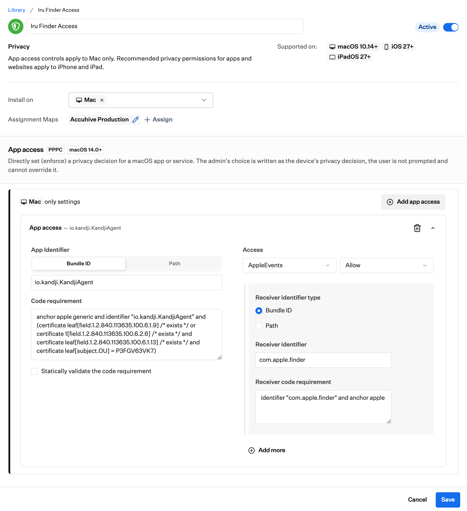

# Give the Iru Agent access to Finder

Some scripts need the Iru Agent to control Finder. Create a Privacy Library Item so the agent can send Apple Events to Finder.

Create a Privacy Library Item, set **Install on** to **Mac**, and in **Mac only settings** select **Add app access**. Then enter the details below.

For help with the Library Item, see [Configure the Privacy Library Item](https://docs.iru.com/en/endpoint/library/library-items-profiles/configure-the-privacy-library-item).

>[!NOTE]
>The identifier and code requirement still say Kandji. This is expected. The Iru Agent bundle ID has not changed.

- **App Identifier:** Bundle ID
- **Identifier:**
  ```
  io.kandji.KandjiAgent
  ```
- **Code requirement:**
  ```
  anchor apple generic and identifier "io.kandji.KandjiAgent" and (certificate leaf[field.1.2.840.113635.100.6.1.9] /* exists */ or certificate 1[field.1.2.840.113635.100.6.2.6] /* exists */ and certificate leaf[field.1.2.840.113635.100.6.1.13] /* exists */ and certificate leaf[subject.OU] = P3FGV63VK7)
  ```
- Leave **Statically validate the code requirement** unchecked.
- **Access:** AppleEvents, Allow
- **Receiver identifier type:** Bundle ID
- **Receiver identifier:**
  ```
  com.apple.finder
  ```
- **Receiver code requirement:**
  ```
  identifier "com.apple.finder" and anchor apple
  ```


