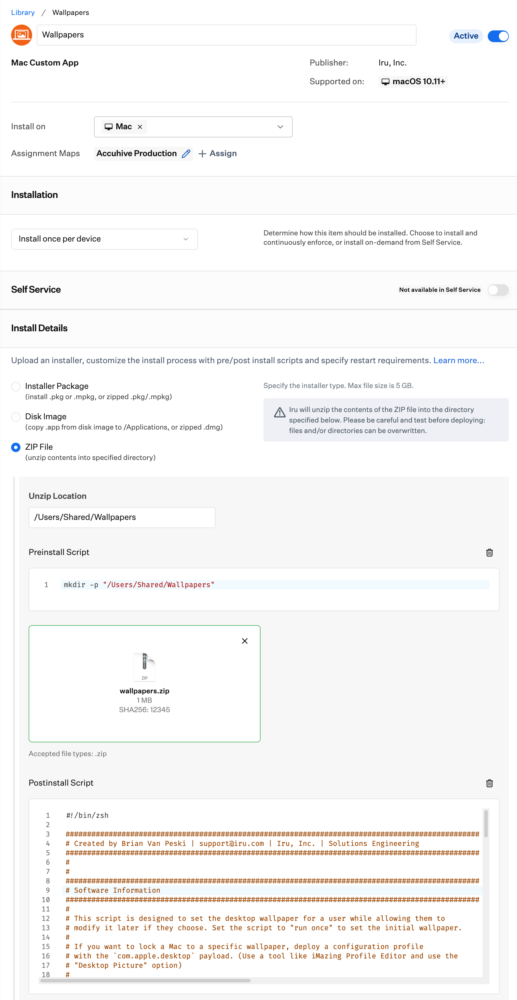

# Set Wallpaper

This script is designed to set a specified image across all connected desktops without requiring the installation of third-party tools or binaries.

You can run it as a custom script or add it as a post-install script to a Custom App Library Item containing your desktop images.

>[!NOTE]
>If you want to set your Desktop image and *lock it in place* to prevent users from making changes, then you should set it [using a configuration profile](https://docs.iru.com/en/endpoint/library/deployment-guides/apple/configure-a-custom-desktop-picture).
You can create that profile with a tool like [iMazing Profile Editor](https://imazing.com/profile-editor).

**Best Practices**
1. Zip up your desktop images and deploy them to a folder that is accessible by all users. (`/Users/Shared/` as an example)
2. Add this script as a post-install to your Custom App Library Item containing your zipped desktop images. (see [example](#custom-app-library-item---wallpaper-example) below)

### Requirements
In order for this script to set the desktop image, the Iru Agent needs access to Finder events. Follow [Give the Iru Agent access to Finder](../iru-finder-access/README.md).

### Custom App Library Item - Desktop Image Example
Create a **Mac Custom App** and set **Install on** to **Mac**. Choose **Install once per device**, leave **Self Service** off, and select **ZIP File**.

- **Unzip Location:**
  ```
  /Users/Shared/Wallpapers
  ```
- **Preinstall Script:**
  ```
  mkdir -p "/Users/Shared/Wallpapers"
  ```
- **ZIP File:** Upload `wallpapers.zip` with `custom_wallpaper.jpg` at the top level of the ZIP, not inside a folder. The script looks for `/Users/Shared/Wallpapers/custom_wallpaper.jpg`.
- **Postinstall Script:** Paste the contents of [setwallpaper.zsh](setwallpaper.zsh).
- Leave **Restart after successful install** unchecked.


